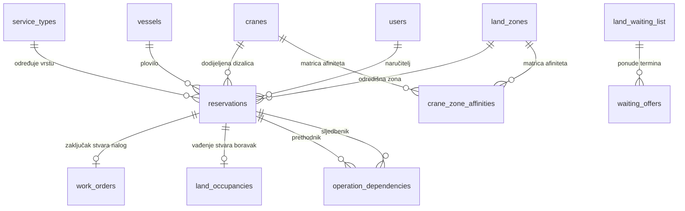

# Dispečerski centar — Kopno & Suhi vez
**Konačna funkcionalna i implementacijska specifikacija v3.2**

| Metapodatak | Vrijednost |
|---|---|
| **Projekt** | Crane Booking App |
| **Modul** | Kopno i suhi vez |
| **Glavna ruta** | `/admin/land-hub?tab=dispatch` |
| **Polazna grana** | `development` |
| **Temelj** | `Dispecher specifikacija.txt` (v3.0) + Povratne informacije korisnika (v3.2) |
| **Status** | Usklađena i odobrena specifikacija za implementaciju |

---

## 1. Temeljna načela sustava

1. **Rezervira se operacija, a ne dizalica.** Dizalica je dodijeljeni resurs, kapacitet kopna je uvjet izvedivosti.
2. **Operacije dizalice su isključivo:**
   - **Podizanje na kopno** (`lift_from_sea`)
   - **Spuštanje u more** (`lower_to_sea`)
   - *(Interno: Blokada / Održavanje dizalice — `maintenance`)*
   > **Napomena o premještanju:** Premještanje *nije* operacija dizalice. Plovilo koje je već na kopnu premješta se kopnenim putem (traktor / kolica); to je isključivo administrativna promjena zone u evidenciji suhog veza.
3. **Kapacitet zone: 1 plovilo = 1 mjesto.**
   - Maksimalna duljina plovila u marini je 15 metara.
   - Nema složenih koeficijenata ni m² kalkulacija; zbirni kapacitet zone računa se u broju plovila (mjesta).
4. **Pravilo raspoloživosti kapaciteta (*Available-to-Promise*):**
   - **Podizanje rezervira mjesto od početka operacije.** Brod izvađen iz mora mora imati osigurano mjesto na kopnu čim ga dizalica podigne.
   - **Spuštanje oslobađa mjesto tek po završetku operacije.**
   - Stvarna fizička zauzetost (`land_occupancies`) mijenja se tek potvrđenim zaključivanjem operacije.
5. **Model timova: „Black Box” kapacitet (2 tima) uz dispečerski override.**
   - Timovi se ne vode poimence niti se prate članovi, smjene ili pojedinačne kvalifikacije (svi operateri su osposobljeni za rad s dizalicama).
   - Tim predstavlja **ograničenje istovremenog rada**: u istom 30-minutnom slotu mogu raditi najviše **2 dizalice istovremeno** (ograničeno brojem raspoloživih timova, parametar u postavkama, zadano = 2).
   - **Dispečer ima pravo ručnog override-a** ako se na terenu privremeno osigura dodatna posada ili ispomoć.
6. **Radno vrijeme iz postavki Sezone:**
   - Standardno radno vrijeme je **07:00 – 15:00** (nema smjena, nema dnevnika primopredaje).
   - Dinamički se čita iz modula `seasons` (aktivna sezona za odabrani datum).
   - Međuprostor (buffer) između operacija je **0 minuta** (slot od 30 min pokriva cjelokupan manipulativni proces).
7. **Izvršenje i zaključivanje:**
   - Za sada **nema mobilnog pritiskanja „Započni” / „Završi” na rivi**.
   - Operater ili dispečer na kraju dana (ili po povratku u ured) kroz sučelje jednim klikom **zaključuje operacije i generira/zaključuje radne naloge**.
8. **Tvrda pravila određuju što je moguće, afiniteti što je poželjno:**
   - Fizička ograničenja (nosivost dizalice, gabariti bazena, tehnička zabrana pristupa zoni) su apsolutna i ne mogu se zaobići.
   - **Kapacitet timova:** Ako su raspoloživi timovi zauzeti (npr. 2/2), sustav postavlja upozorenje, ali **dispečer ima puno pravo ručnog override-a** za zakazivanje dodatne operacije uz kratku zabilješku.
   - Sustav transparentno objašnjava zašto je opcija preporučena, zašto je upozoravajuća ili zašto je tehnički odbijena.

---

## 2. Model operacija i kapaciteta

### 2.1. Vrste operacija
| Vrsta operacije | Šifra | Utjecaj na kopno | Kada utječe na projekciju? |
|---|---|---|---|
| **Podizanje na kopno** | `lift_from_sea` | Zauzima 1 mjesto | **Na početku termina** (rezervacija mjesta) |
| **Spuštanje u more** | `lower_to_sea` | Oslobađa 1 mjesto | **Na kraju termina** (stvarni odlazak s kopna) |
| **Održavanje dizalice** | `maintenance` | Nema utjecaja | Blokira termine dizalice |

### 2.2. Promjena zone (bivše „premještanje”)
- Plovilo koje već ima aktivan zapis u `land_occupancies` (`returned_at IS NULL`) može promijeniti zonu:
  - U tabu **Zone** ili u kartici plovila klikne se akcija **„Promijeni zonu”**.
  - Ako ciljna zona ima raspoloživog kapaciteta, ažurira se `land_occupancies.zone_id`.
  - Operacija dizalice se za ovo **ne zakazuje**.

### 2.3. Kronološka projekcija kapaciteta (po satima)
Za svaku zonu na odabrani dan:
- **Početno stanje ($T_0$):** Aktivna plovila na kopnu (`returned_at IS NULL`).
- **Kronološki tijek:**
  - Svako planirano/potvrđeno podizanje u zoni u trenutku $t_{start}$: $\text{slobodno} - 1$.
  - Svako planirano/potvrđeno spuštanje iz zone u trenutku $t_{end}$: $\text{slobodno} + 1$.
- **Ključni indikatori zone za dispečera:**
  - Trenutno slobodno
  - Stanje na kraju dana (neto bilanca)
  - **Najniža točka dana (*minimum free today*) i točno vrijeme kada nastupa deficit**
  - Ako u bilo kojem trenutku slobodno padne ispod 0, zona ulazi u **Deficit** i blokira daljnje potvrđivanje podizanja u tim satima.

### 2.4. Uvjetne operacije (Rotacija isti dan)
- Ako vlasnik želi podizanje u 09:00 u zoni A1 koja ima 0 slobodnih mjesta, ali u 08:30 završava spuštanje u istoj zoni:
  - Sustav prepoznaje da je operacija **izvediva uz ovisnost**.
  - Kreira se relacija `operation_dependencies` (`dependency_type = 'capacity_release'`).
  - U dispečerskom rasporedu obje operacije dobivaju vizualnu poveznicu rotacije.

---

## 3. Upravljanje resursima: Dizalice i Timovi

### 3.1. Tri aktivne dizalice
1. **Travelift 50T** (teška plovila, katamarani, jedrilice veće mase)
2. **Stacionarna dizalica 5T** (srednja plovila do 5 tona)
3. **Mala dizalica** (manja plovila, gliseri, brza spuštanja/vađenja)

**Tvrda ograničenja dizalice:**
- Masa plovila $\le$ nosivost dizalice.
- Širina plovila $\le$ maksimalna širina bazena dizalice (za Travelift).
- Dizalica je tehnički dopuštena za traženu zonu (`is_allowed = true` u matrici afiniteta).
- Dizalica nije u kvaru, održavanju ili obustavi rada.

### 3.2. Timovi kao kapacitet istovremenog rada i dispečerski override
- Broj timova je konfigurabilan (zadana vrijednost u sustavu = 2).
- **Zadano pravilo:** U bilo kojem 30-minutnom slotu broj istovremeno aktivnih operacija na svim dizalicama načelno **ne bi trebao prelaziti broj raspoloživih timova** (npr. 2 dizalice rade istovremeno od 09:00 do 09:30).
- Ako su zakazane 2 operacije u 09:00, treća dizalica u tom slotu dobiva status **„Nema raspoloživog tima (prekoračen kapacitet 2/2)”**.
- **Pravo ručnog override-a za dispečera:** Dispečer ima puno pravo aktivirati **„Override tima”** prilikom dodjele ili potvrde treće operacije (npr. privremena preraspodjela ljudi na terenu, ispomoć ili hitna intervencija) uz unos kratke napomene. U tom slučaju sustav dopušta operaciju i ne blokira zakazivanje.
- Dispečer ne mora voditi pojedinačne radnike — sustav samo prati zbirnu iskorištenost timova uz mogućnost override-a.

---

## 4. Radno vrijeme i obustave rada

### 4.1. Radno vrijeme iz Sezona
- Nema fiksnog kodiranja radnog vremena (npr. 07:00–19:00).
- Sustav za odabrani datum iz tablice `seasons` dohvaća aktivno radno vrijeme (npr. radnim danom 07:00 – 15:00, vikendom zatvoreno ili skraćeno).
- Praznici (`holidays`) automatski blokiraju redovno planiranje.
- Vremenska zona: isključivo `Europe/Zagreb`.

### 4.2. Izvanredne obustave rada (Vremenske nepogode / Bura / Jugo)
- Dispečer jednim klikom može aktivirati **Obustavu rada** (`work_stoppages`):
  - Opseg: Sve dizalice ili pojedinačna dizalica.
  - Vrijeme: Od određenog sata do daljnjega (ili do zadanog vremena).
  - Razlog: Vjetar / bura, kvar, visoka plima, tehnički radovi.
- **Učinak obustave:**
  - Trenutno blokira zakazivanje novih operacija u tom razdoblju.
  - Prikazuje panel **„Pogođene operacije”** s popisom svih ranije potvrđenih termina koji padaju pod obustavu.
  - Dispečer jednim klikom može poslati obavijest vlasnicima i ponuditi prvi slobodan zamjenski termin.

---

## 5. Lista čekanja i neraspoređeni zahtjevi

### 5.1. Razlika: Neraspoređeni zahtjev vs. Lista čekanja
1. **Neraspoređeni zahtjev (`pending` rezervacija):**
   - Vlasnik je zatražio vađenje ili spuštanje na određeni datum.
   - Zahtjev je tehnički potpun, ali još čeka da dispečer potvrdi točan slot dizalice i zonu.
2. **Lista čekanja (`land_waiting_list`):**
   - Vlasnik želi podizanje na kopno, ali u željenoj zoni **nema slobodnog mjesta**.
   - Zahtjev stoji u redu prema datumu prijave (FIFO).
   - Čim se u zoni oslobodi mjesto (npr. nakon spuštanja drugog broda), sustav na vrhu liste dispečeru nudi kandidata.

### 5.2. Ponuda termina sa zadržavanjem mjesta (*Hold*)
- Kada se oslobodi mjesto, dispečer klikne **„Ponudi termin”**:
  - Unosi se predloženi datum i termin.
  - Generira se zapis u `waiting_offers` s rokom trajanja ponude (npr. 24 sata).
  - **Dok ponuda traje, mjesto na kopnu i termin dizalice su PRIVREMENO REZERVIRANI** (sustav ih ne nudi drugima).
  - Ako vlasnik prihvati $\rightarrow$ ponuda postaje potvrđena rezervacija.
  - Ako vlasnik odbije ili istekne 24h $\rightarrow$ rezervacija se otpušta, a pravo prelazi na sljedećeg na listi.

---

## 6. Korisničko sučelje: Jednostavan Dispečerski centar

Sučelje se nalazi na ruti `/admin/land-hub` i sastoji se od **tri operativna taba** i administrativnih postavki:

```
┌─────────────────────────────────────────────────────────────────────────────┐
│  KOPNO I SUHI VEZ — DISPEČERSKI CENTAR                                      │
│  [ Tab 1: Dispečer ]    [ Tab 2: Zone ]    [ Tab 3: Lista čekanja ]  [Postavke⚙]│
└─────────────────────────────────────────────────────────────────────────────┘
```

### 6.1. Tab 1: Dispečer (`?tab=dispatch`)
Glavni radni ekran organiziran u 3 intuitivna stupca:

1. **Gornja navigacijska traka:**
   - Odabir datuma (Danas, Dan natrag / naprijed), prikaz radnog vremena iz sezone (npr. 07:00–15:00).
   - Glavni KPI indikatori: Broj operacija, Zauzetost timova (npr. 2/2), Slobodno na kopnu, Broj zahtjeva, Konflikti.
   - Gumb za brzu aktivaciju **„Obustava rada (Vjetar)”**.
2. **Lijevi stupac — Zahtjevi i čekanje:**
   - Kartice zahtjeva koji čekaju raspored.
   - Svaka kartica ima 3 jasne točke provjere:
     - [✓] Prikladna dizalica
     - [✓] Slobodan termin (dizalica + tim)
     - [✓ / ✗] Kapacitet zone na kopnu
   - Gumb **„Pronađi kombinaciju”** $\rightarrow$ sustav automatski nudi najbolju dizalicu i termin s objašnjenjem bodovanja.
3. **Srednji stupac — Timeline dizalica (3 fiksna stupca):**
   - Točno 3 stupca za 3 dizalice (*Travelift 50T*, *Stacionarna 5T*, *Mala dizalica*).
   - Vremenska mreža u slotovima od **30 minuta** unutar sezonskog radnog vremena (07:00 – 15:00).
   - Kartice operacija s jasnim oznakama:
     - `↑` Vađenje (plavo)
     - `↓` Spuštanje (zeleno)
     - Ikona lanca za rotacijske ovisnosti.
     - Žuto/crveno upozorenje ako je operacija u konfliktu.
4. **Desni stupac — Stanje i projekcija 6 zona:**
   - Kartice za 6 zona: Servisna zona (SZ), Arla 1 (A1), Arla 2 (A2), Arla 3 (A3), Zapadna obala (ZO), Lukobran (LB).
   - Prikaz: Početno stanje, Planirani ulasci/izlasci, Stanje na kraju dana, **Najniža točka dana**.
   - Klik na zonu filtrira srednji timeline samo na operacije povezane s tom zonom.

### 6.2. Tab 2: Zone i zauzeće (`?tab=zones`)
- Tablični i vizualni pregled svih plovila koja se trenutno fizički nalaze na kopnu.
- Mogućnost brze administrativne akcije **„Promijeni zonu”** (kopneno premještanje plovila bez dizalice).
- Ručna evidencija neevidentiranih plovila (`manual_occupied_spots`) kao prijelazno rješenje.

### 6.3. Tab 3: Lista čekanja (`?tab=waiting`)
- Prikaz aktivnih kartica na listi čekanja s rednim brojem prioriteta i datumom prijave.
- Akcije: **„Ponudi termin”**, **„Promijeni prioritet (uz razlog)”**, **„Otkaži zahtjev”**.
- Prikaz statusa prethodno poslanih ponuda (Aktivna ponuda, Prihvaćeno, Odbijeno, Isteklo).

### 6.4. Tab 4: Postavke (Samo administratori)
- Matrica afiniteta dizalica i zona (`is_allowed`, `affinity_score` 0–100, `penalty_slots`).
- Broj raspoloživih timova (zadano = 2).
- Sigurnosni faktori i ograničenja dizalica.

---

## 7. Životni ciklus i zaključivanje na kraju dana

Budući da operateri na rivi za sada ne koriste mobilnu aplikaciju za označavanje početka i kraja, radni tijek je prilagođen uredskom radu:

1. **Jutro / Dan ranije:**
   - Dispečer raspoređuje zahtjeve i potvrđuje termine na timelineu.
   - Ispisuje se ili pregledava dnevni raspored za radnike na rivi.
2. **Tijekom dana:**
   - Radnici na rivi obavljaju podizanja i spuštanja prema rasporedu.
   - Ako dođe do odgode (npr. vlasnik kasni ili bura), dispečer na računalu pomiče termin ili unosi obustavu.
3. **Kraj dana — Zaključivanje operacija:**
   - Na dnu ekrana dispečera nalazi se traka: **„Današnje operacije za zaključenje”**.
   - Za svaku odrađenu operaciju dispečer jednim klikom potvrđuje **„Zaključi operaciju”**:
     - Potvrđuje se stvarna zona na kopnu (ako je kod vađenja plovilo smješteno u drugu zonu od planirane).
     - Automatski se zatvara povezani Radni nalog (`work_orders`).
     - Ažurira se evidencija zauzetosti na kopnu (`land_occupancies`: kod vađenja se stvara aktivan boravak, kod spuštanja se upisuje datum povratka).
     - Evidentira se potrošnja statutarnih prava člana ili priprema stavka za naplatu.
   - Ako operacija nije održana (npr. brod nije došao), dispečer bira **„Označi: Nije izvedeno”** uz odabir razloga.

---

## 8. Relacijski podatkovni model (Drizzle / PostgreSQL)

Sustav se oslanja na postojeće provjerene tablice uz minimalna i precizna proširenja:



### 8.1. Postojeće tablice koje se koriste
- `cranes`: Točno 3 aktivne dizalice (*Travelift 50T*, *Stacionarna 5T*, *Mala dizalica*).
- `land_zones`: 6 zona (A1, A2, A3, SZ, ZO, LB) sa stupcem `total_spots` (kapacitet mjesta).
- `land_occupancies`: Evidencija fizičkog boravka na kopnu (`returned_at IS NULL` = zauzeto).
- `work_orders`: Službeni radni nalozi, statutarna prava, ERP i naplata.
- `seasons`: Radno vrijeme marina po datumima.
- `settings`: Sistemske postavke (uključujući `maxConcurrentTeams: 2`).

### 8.2. Proširenja tablica
1. **`reservations`**:
   - `space_units`: Broj zauzetih mjesta (integer, zadano 1).
   - `not_performed_reason`: Tekstualni razlog ako operacija nije održana.
   - Status enum proširen na: `pending`, `approved`, `completed`, `not_performed`, `cancelled`.
2. **`crane_zone_affinities`**:
   - `is_allowed`: Boolean (tehnička dopuštenost).
   - `affinity_score`: Integer 0–100 (operativna preferencija za rangiranje).
   - `penalty_slots`: Integer (dodatni utrošak slotova ako je pristup otežan).
3. **`operation_dependencies`**:
   - `predecessor_reservation_id`: ID operacije spuštanja koja oslobađa mjesto.
   - `successor_reservation_id`: ID operacije vađenja koja čeka to mjesto.
   - `dependency_type`: `'capacity_release'`.
4. **Nove jednostavne pomoćne tablice:**
   - `work_stoppages`: Zabilježene obustave rada (bura, kvar, radovi).
   - `waiting_offers`: Zapis poslanih ponuda s rokom važenja i privremenom rezervacijom.

---

## 9. Plan uvođenja iz grane `development`

Uvođenje se provodi čisto i kontrolirano iz grane **`development`**:

| Korak | Naziv | Opis |
|---|---|---|
| **Korak 1** | **Baza i migracije** | Kreiranje Drizzle migracija za proširenja sheme (`work_stoppages`, `waiting_offers`, ažuriranje `crane_zone_affinities`). |
| **Korak 2** | **Poslovna logika (Services)** | Implementacija čistih backend servisa u `server/landDispatch/`: izračun kapaciteta (ATP), provjera 2 tima, provjera dizalice, bodovanje afiniteta, detekcija deficita. |
| **Korak 3** | **tRPC Router** | Definiranje procedura `landDispatch.*` za dohvat plana, neraspoređenih zahtjeva, zona, konflikata i zaključivanja dana. |
| **Korak 4** | **Sučelje (UI)** | Izrada intuitivnog ekrana `/admin/land-hub` s 3 taba (Dispečer, Zone, Lista čekanja) i dijalogom preporuke termina. |
| **Korak 5** | **Testni scenariji** | Izrada automatiziranih testova: provjera blokade kod istovremenog rada više od 2 dizalice, provjera rotacije isti dan, provjera deficita na kopnu. |

---

## 10. Sažetak prednosti specifikacije v3.2

- **Nema nepotrebnog administrativnog opterećenja:** Nema vođenja radnika, smjena i kvalifikacija — timovi su jednostavan operativni limit od 2 istovremene operacije, uz **punu fleksibilnost dispečerskog override-a** kad je to potrebno na terenu.
- **Stopostotna fizička sigurnost:** Brod se ne podiže ako u tom trenutku na kopnu nema slobodnog mjesta.
- **Potpuna operativna jasnoća:** Premještanje ne troši termin dizalice, a dispečer na kraju dana brzo i pregledno zaključuje odrađeni posao i radne naloge.
- **Prilagođeno stvarnom radu u marini:** Uvažene vremenske nepogode (bura/jugo), radno vrijeme iz sezona i princip 1 brod = 1 mjesto.
